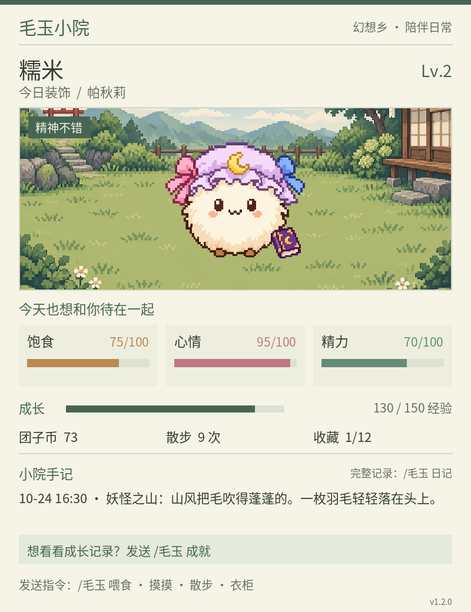
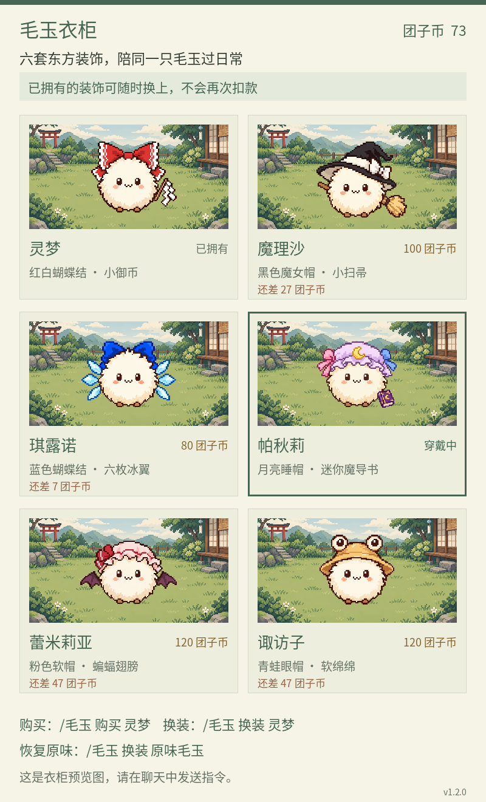
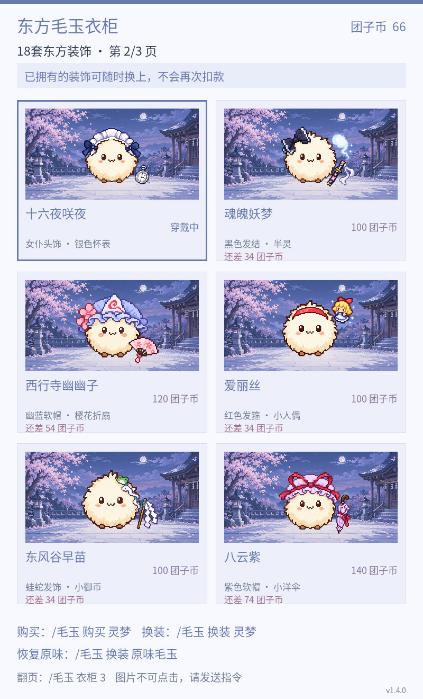
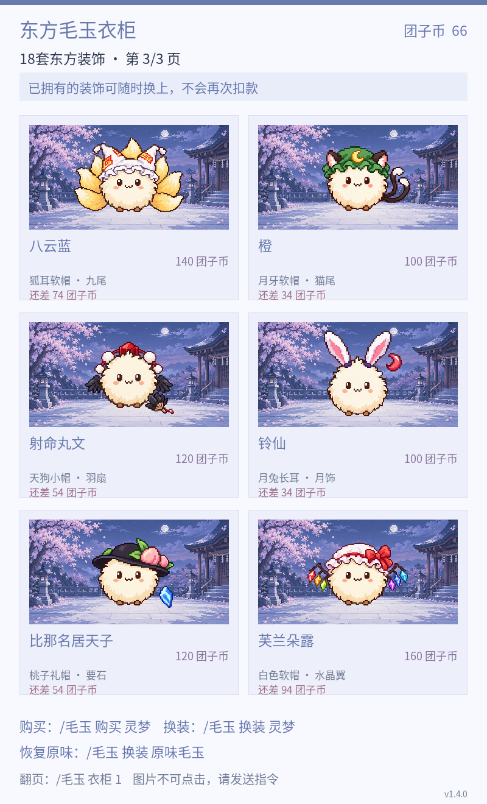

# 东方毛玉小院

领养一只软乎乎的毛玉，喂点心、摸摸、出门散步，把幻想乡的小纪念品带回家。

支持 **AstrBot** 和 **Koishi**。本地存档，离线养成，18套东方主题装饰。






## AstrBot 安装

在 AstrBot 的插件管理中选择“从链接安装”，填写：

```
https://github.com/pacholigoooo/astrbot_plugin_maoyu
```

安装后发送 `/毛玉 帮助`，再发送 `/毛玉 领养 糯米`。

- 环境：AstrBot 4.9.2+，依赖 Pillow。
- 后续可在插件管理中更新；升级前备份数据，保留 `data/plugin_data/astrbot_plugin_maoyu/`。
- 也可从 Releases 下载 ZIP 安装。实际唤醒前缀与是否需要 @机器人，以你的 AstrBot 配置为准。

## Koishi 安装

在 Koishi 应用目录执行：

```
npm install git+https://github.com/pacholigoooo/astrbot_plugin_maoyu.git#main
python3 -m pip install -r node_modules/koishi-plugin-maoyu-courtyard/requirements.txt
```

在控制台启用 `maoyu-courtyard`，发送 `毛玉 帮助`。

需要 Koishi 4.18+、Node.js 18+、同一环境中的 Python 3.10+ 和 Pillow。Windows 可使用 `python`；虚拟环境请在插件配置中填写解释器路径。详细步骤见 [Koishi 安装指南](KOISHI.md)。

更新时重新安装上述 GitHub main 引用并重启插件。数据位于 Koishi 应用目录的 `data/maoyu-courtyard/`，与 AstrBot 存档分开。

## 怎么玩

| 指令 | 作用 |
|---|---|
| `/毛玉 领养 名字` | 领养一只毛玉，默认名为糯米 |
| `/毛玉 看看` | 查看状态与小院像素卡 |
| `/毛玉 改名 名字` | 免费改名，1～12字 |
| `/毛玉 喂食` | 免费米糕，补充饱食，15分钟冷却 |
| `/毛玉 摸摸` | 提升心情，10分钟冷却 |
| `/毛玉 玩耍` | 消耗精力换取心情与经验，30分钟冷却 |
| `/毛玉 散步` | 探访幻想乡，获得团子币和纪念品，1小时冷却 |
| `/毛玉 睡觉` | 恢复精力，4小时后自然醒 |
| `/毛玉 起床` | 提前叫醒毛玉 |
| `/毛玉 签到` | 每天领取40团子币，默认北京时间零点换日 |
| `/毛玉 衣柜 1` | 查看衣柜第1页，可选1～3页 |
| `/毛玉 购买 名称` | 解锁并穿上装饰，首套免费任选 |
| `/毛玉 换装 名称` | 切换已拥有的装饰；“原味”可卸下装饰 |
| `/毛玉 图鉴` | 查看12种散步收藏 |
| `/毛玉 日记` | 查看最近5次散步手记 |
| `/毛玉 成就` | 查看6项成长目标与奖励 |
| `/毛玉 动图` | 发送轻晃的毛玉GIF |
| `/毛玉 帮助` | 查看指令菜单 |

Koishi 使用相同的“毛玉”指令，前缀以 Koishi 设置为准。卡片是展示图片，请在聊天框输入指令。

## 18套东方装饰

- 第1页：灵梦、魔理沙、琪露诺、帕秋莉、蕾米莉亚、诹访子。
- 第2页：十六夜咲夜、魂魄妖梦、西行寺幽幽子、爱丽丝、东风谷早苗、八云紫。
- 第3页：八云蓝、橙、射命丸文、铃仙、比那名居天子、芙兰朵露。

第一套免费，之后售价80～160团子币。装饰永久保留，只有外观区别。支持“帕琪、蕾米、咲夜、妖梦、幽幽子、早苗、天子、芙兰”等简称。

## 陪伴与存档

每个用户在不同群独立养一只，私聊另存。长期没上线也不会死亡或丢失装饰。签到、散步和成就可获得团子币，经验会提升等级。

数据保存在本机，默认每日自动备份并保留7份。更新插件时不要删除数据目录；恢复备份应先停止机器人。

插件设置可调整发图开关、互动冷却倍率、签到时区和自动备份。图片/GIF发送能力取决于消息适配器，可关闭图片使用文字模式。

## 项目资料

- [更新日志](CHANGELOG.md) · [验证记录](TEST_REPORT.md) · [数据说明](PRIVACY.md) · [素材说明](ARTWORK.md)
- 代码采用 MIT；字体采用 SIL OFL 1.1。
- 美术为 AI 生成的东方同人素材。东方Project相关权利归原权利人，本项目为非官方同人作品。
- 玩法结构参考 [astrbot_plugin_pet](https://github.com/DITF16/astrbot_plugin_pet)，未复制其代码或图片。
